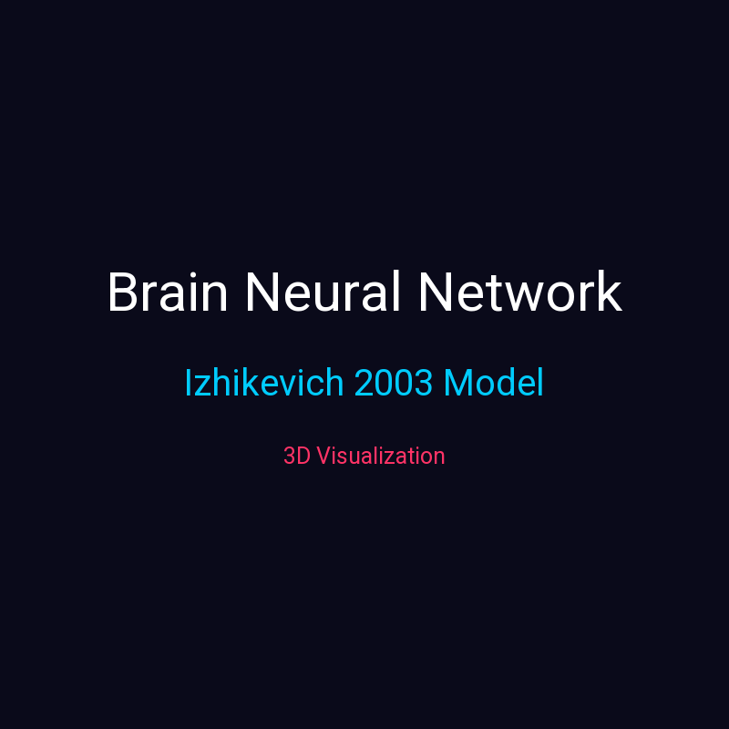

# 🧠 Izhikevich Brain Simulation (Gamma & STDP)

A biologically realistic spiking neural network simulation based on the **Izhikevich (2003)** model. This project demonstrates **Gamma oscillations (40 Hz)** driven by thalamic input, implemented in Python and visualized in both 2D (Matplotlib) and 3D (Video).

## 📺 Watch the 3D Simulation
[](brain_complete_en.mp4)

*(Click the image above to download/watch the full 3D video with procedural music)*

## 🔬 Mathematical Model

The network consists of 1000 neurons (800 excitatory, 200 inhibitory) governed by the Izhikevich differential equations:

$$ \frac{dv}{dt} = 0.04v^2 + 5v + 140 - u + I $$
$$ \frac{du}{dt} = a(bv - u) $$

**Spike Reset Condition:**
If \( v \ge 30 \text{ mV} \), then:
$$ v \leftarrow c $$
$$ u \leftarrow u + d $$

### Neuron Types & Parameters
The parameters \( a, b, c, d \) define the firing patterns of the neurons:
*   **Excitatory (RS - Regular Spiking):** \( a=0.02, b=0.2, c=-65, d=8 \)
*   **Inhibitory (FS - Fast Spiking):** \( a=0.1, b=0.2, c=-65, d=2 \)

## ⚡ Gamma Oscillations (PING Model)

Gamma rhythms (30-80 Hz) are generated using the **PING (Pyramidal-Interneuron Network Gamma)** mechanism. A 40 Hz thalamic oscillatory drive is applied to the network, causing excitatory and inhibitory populations to synchronize.

### Spike-Timing Dependent Plasticity (STDP)
The network also includes STDP for synaptic learning:
*   **LTP (Long-Term Potentiation):** If Pre-neuron fires before Post-neuron, the synapse is strengthened.
*   **LTD (Long-Term Depression):** If Post-neuron fires before Pre-neuron, the synapse is weakened.

## 🚀 Installation

```bash
pkg update && pkg upgrade
pkg install python ffmpeg -y
pip install numpy matplotlib pillow
```

▶️ Usage

2D Visualization (Activity Map)

```bash
python brain_sim.py
```

Outputs: brain_sim.png (Raster plot, Population activity, Cell distribution)

3D Video Generation

```bash
# 1. Generate the 3D frames
python brain_3d.py
# 2. Generate the procedural music
python muzik.py
# 3. Combine with Intro/Outro
python make_cards.py
ffmpeg -y -loop 1 -t 3 -i intro.png -i brain_3d.mp4 -loop 1 -t 3 -i outro.png -filter_complex "[0:v]scale=800:800,format=yuv420p,setpts=PTS-STARTPTS[v0];[1:v]scale=800:800,format=yuv420p,setpts=PTS-STARTPTS[v1];[2:v]scale=800:800,format=yuv420p,setpts=PTS-STARTPTS[v2];[v0][v1][v2]concat=n=3:v=1:a=0[outv];[1:a]adelay=3000,apad=pad_dur=3[outa]" -map "[outv]" -map "[outa]" -c:v libx264 -crf 23 -pix_fmt yuv420p -c:a aac -b:a 192k brain_complete_en.mp4
```

📊 Outputs

· Raster Plot: Shows spikes of all 1000 neurons over time.
· 3D Network: A rotating sphere where red dots are excitatory, blue dots are inhibitory, and yellow halos indicate firing.

📚 Scientific References

1. Izhikevich, E. M. (2003). Simple model of spiking neurons. IEEE Transactions on Neural Networks, 14(6), 1569-1572.
2. Buzsáki, G., & Wang, X. J. (2012). Mechanisms of gamma oscillations. Annual Review of Neuroscience, 35, 203-225.
3. Song, S., Miller, K. D., & Abbott, L. F. (2000). Competitive Hebbian learning through spike-timing-dependent synaptic plasticity. Nature Neuroscience, 3(9), 919-926.

📄 License

MIT License
